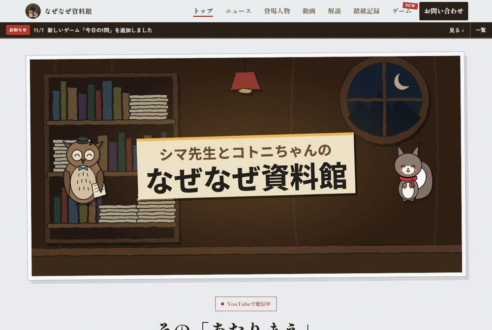
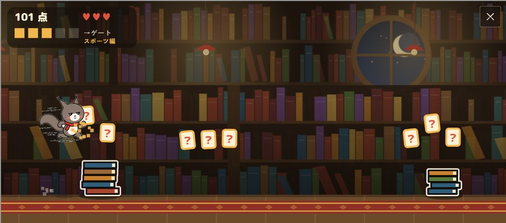
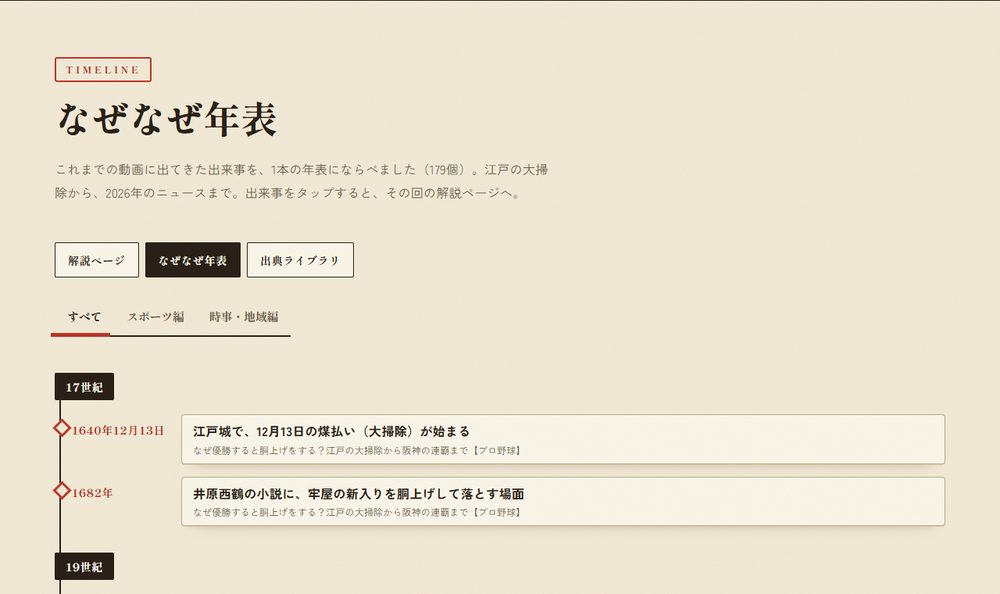
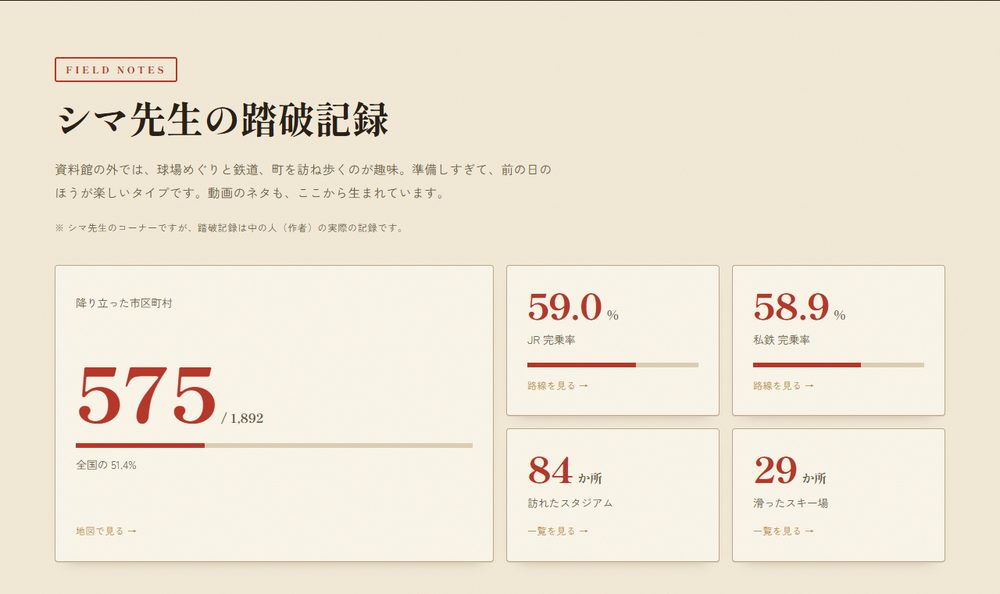
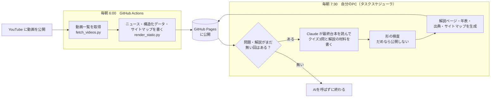

# なぜなぜ資料館 — 公式サイト

YouTube「シマ先生とコトニちゃんのなぜなぜ資料館」の公式サイトです。
企画・デザイン・プログラム・自動化・コンテンツづくりまで、ひとりで作って運用しています。

**▶ サイト：https://iou1996.github.io/nazenaze-shiryokan/**

---

## このサイトでできること

| 機能 | 中身 |
|---|---|
| **動画一覧の自動更新** | 毎朝、YouTube から新しい動画・人気の動画を取ってきて、トップ・ニュース・動画一覧を書きかえる |
| **回ごとの解説ページ（24本）** | 要点・その回の年表・出典・その回だけのクイズ。動画を見なくても読めば中身がわかる |
| **なぜなぜ年表（179件）** | 全部の回に出てきた出来事を1本の年表に。江戸時代から2026年まで。出来事を押すとその回の解説へ |
| **出典ライブラリ（431件）** | 動画で使った新聞・公式記録・論文の一覧。キーワードで検索できる |
| **ゲーム4本** | 資料館ダッシュ（オリジナル絵の横スクロール）／今日の1問／なぜなぜクイズ（89問）／反射ゲーム |
| **踏破記録** | 作者が訪れた市区町村・鉄道路線・スタジアム・スキー場を地図と数字で |
| **サイト内検索** | 解説・用語・年表・クイズ・出典・動画を一度に検索。ひらがな／カタカナ・全角／半角を区別しない。サーバーなし（ブラウザの中で探す） |
| **お知らせ・シェア・お問い合わせ** | お知らせバー、X・LINE へのシェア、Google フォームのお問い合わせ |

### 資料館ダッシュ（ブラウザで動くアクションゲーム）

- 背景（本棚・月の窓・ランプ・じゅうたん）はすべてプログラムで描画。キャラクターは自作の立ち絵から
- 「？」を5枚集めると「なぜなぜゲート」。動画の内容からクイズが出て、正解すると次のゲートまでバリア
- 遊び方は2つ：エンドレス（ライフ3つでどこまで）／タイムアタック（ゲート5つを何秒で）
- スマホはタップ、パソコンはスペースキー。スマホでは自動で全画面になり、横持ちにも対応
- 連打で選択肢を押しまちがえないよう、クイズの前に一度止めて、選択肢を1秒ほど押せなくしている

### なぜなぜ年表と踏破記録

---

## 自動化のしくみ

新しい動画を公開すると、**次の朝までに、サイトに必要なものが手作業なしでそろいます。**

| 新しい回を公開したあとにやること | 手でやると | いま |
|---|---|---|
| 動画一覧・ニュース・人気の動画を更新 | ページを書きかえ | 自動（毎朝） |
| 検索エンジン向けの情報（構造化データ・サイトマップ） | 1本ずつ追記 | 自動 |
| その回のクイズ3問 | 台本を読みなおして作問 | 自動（台本から作って検査） |
| 解説ページ・年表・出典ライブラリへの追加 | ページを1から作成 | 自動 |

- 対象の回が無い日は AI を呼ばない（ムダな実行をしない）
- AI が書いたものは、決まった形になっているかをプログラムで検査し、だめなら前の状態に戻して公開しない
- 動画一覧の取得は API キーなしでも動く（動画タブ → RSS の順に試す）

---

## 動画づくりの分業（AIエージェント）

動画そのものも、工程ごとに役割を分けたAIエージェントと作っています。**事実確認の「関所」を3回通さないと次へ進めない**のが決まりです。

| 順 | 工程 | 担当 |
|---|---|---|
| 1 | ネタ集め・リサーチ（当時の新聞・公式記録・論文まで、出典URLつき） | リサーチ係 |
| ★ | 関所1：リサーチのファクトチェック | ファクトチェック係 |
| 2 | 台本（掛け合い） | 統括 |
| ★ | 関所2：台本の点検（芯のずれ・冗長・不自然な掛け合い） | 台本点検係 |
| ★ | 関所3：台本のファクトチェック | ファクトチェック係 |
| 3 | 音声と読み（人名・地名・数字の読みちがいを全行チェック） | 読みチェック係 |
| 4 | 動画・サムネ・題名・概要欄 | 統括 |
| ★ | 映像の合格 | **人が見て決める** |
| ◎ | 公開後の数字の見方・次の打ち手の提案 | マーケティング係 |

- 公開・アップロードは必ず人がする。AI は提案と下書きまで
- 回ごとに「進行表」を置き、どの工程が済んだかを1行ずつ残す。同時に何本も進められる

---

## 技術

- **フロント**：素の HTML / CSS / JavaScript（フレームワークなし）。ゲームは Canvas
- **地図**：Leaflet ＋ 国土地理院タイル
- **生成**：Python（ページ・年表・出典・サイトマップを JSON から書き出す）
- **公開・定期実行**：GitHub Pages ／ GitHub Actions ／ Windows タスクスケジューラ ＋ Claude Code
- **検索対策**：構造化データ（VideoObject・BreadcrumbList）、サイトマップ、OGP、Search Console 登録済み
- **スマホ**：360px 幅・文字を大きくした設定でも崩れないことを確認。古いページが残らないよう、版が上がると自動で読みなおす
- **運用コスト**：サーバー代 0円（GitHub Pages）

---

## お仕事のご相談

「こういうサイトがほしい」「この作業を自動にしたい」「解説動画・教材を作りたい」など、
**[お問い合わせフォーム](https://iou1996.github.io/nazenaze-shiryokan/contact.html)** からお気軽にどうぞ。
